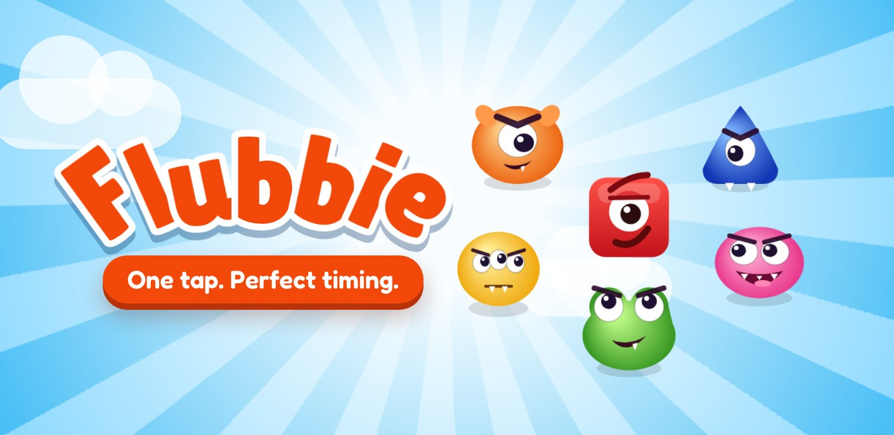
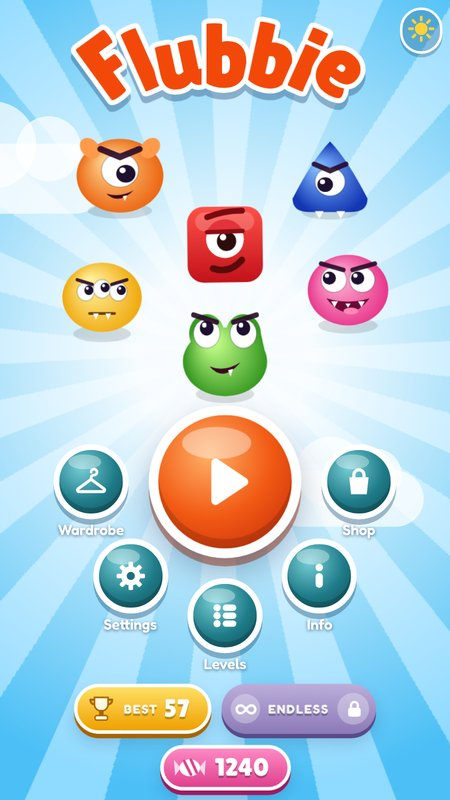
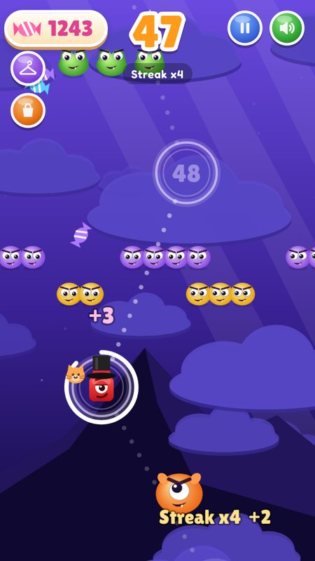
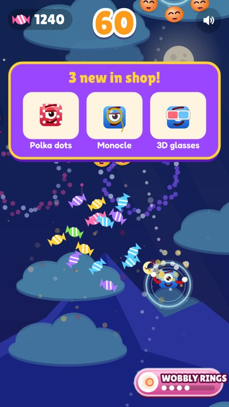
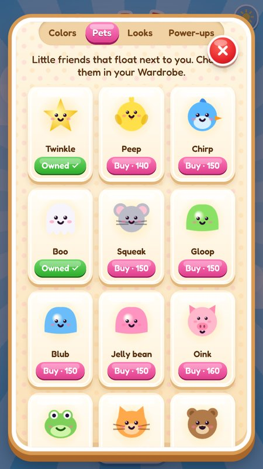
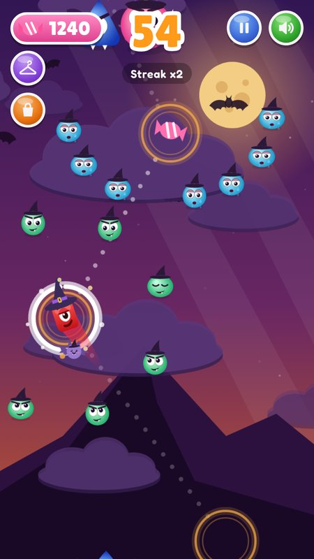
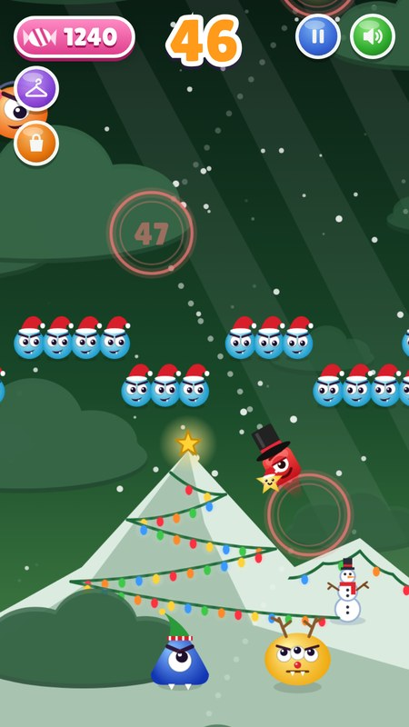

<p align="center">
  
</p>

<p align="center">
  <b>Leap from ring to ring, slip between the monsters, and climb all the way to the Golden Ring.</b><br>
  A colorful one-tap arcade game that runs right in your browser.
</p>

<p align="center">
  <a href="https://agmcorp.github.io/flubbie/"></a>
  &nbsp;
  <a href="https://agmcorp.itch.io/flubbie"></a>
</p>

<p align="center">
  
  
  
</p>

## How to play

Flubbie sits in a ring. **Tap the screen** (or press <kbd>Space</kbd>) to jump to the next one.

The monsters move in patterns: watch them, wait for the gap, and go. But don't wait too long, because every ring has its own timer. Hit a monster and you fall back to your last checkpoint.

## What's inside

- **A long climb** with a boss every few rings, a celebration at each milestone, and a surprise waiting at the Golden Ring
- **Power-ups and tricks**: power ball, shield, shockwave, slow and fast clocks, tiny potion, magnet, freeze, candy rain, a hungry monster friend, and a couple of sneaky curses
- **Endless mode**, unlocked at the top: the rings never stop, so how high can you go?
- **A candy shop and a wardrobe** full of colors, looks and pets that float by Flubbie's side (see below)
- **Prizes** to win along the way, from a mustache to the royal crown
- **Seasonal looks**: Halloween and Christmas (see below)
- **Share your record** as a picture and challenge your friends
- Plays on phones and computers, nothing to install

## Colors, looks and pets

Collect candies on the way up and spend them in the shop. Everything you own is chosen in the wardrobe: the color and the look show up wherever Flubbie appears, and the pet floats by its side while you play.

<p align="center">
  
</p>

## Seasonal looks

Tap the season button in the corner of the menu to switch between **Classic**, **Halloween** and **Christmas**, any day of the year. The sky, the monsters and the pets dress up for the occasion, while the game stays the same. During the holidays the game opens in the season's look on its own, unless you picked another one.

<table align="center">
  <tr>
    <td align="center"><br><b>Halloween</b><br>Night skies, bats, and a witch, a mummy, a pumpkin and more</td>
    <td align="center"><br><b>Christmas</b><br>A mountain lit up like a Christmas tree, a snowman, Santa's sleigh flying by, holly on the cards, falling snow, reindeer and Santa hats</td>
  </tr>
</table>

## Run it locally

The whole game is a single `index.html` with its music and sound effects next to it. Browsers block sound files opened straight from disk, so serve the folder with any small web server:

```bash
python3 -m http.server 8000
```

Then open <http://localhost:8000>.

The same files are published with GitHub Pages at <https://agmcorp.github.io/flubbie/>.

## Project layout

```
index.html        the whole game: graphics, logic and styles
*.mp3             music: menu, game, game over and finale
sfx/              sound effects
docs/             images for this page (not part of the game)
```

To publish on itch.io, zip `index.html`, the `.mp3` files and the `sfx/` folder.

## History

Flubbie was born in 2020 as a mobile game built with Unity. This is its browser edition, rebuilt from scratch with new characters, power-ups, bosses and a whole lot more. The original still lives at [agmcorp.itch.io/flubbie-original](https://agmcorp.itch.io/flubbie-original).

## Credits

**Game and design:** Álvaro G. Morales (AGMCORP)<br>
**Sounds:** Freesound.org and IndieGameMusic.com

Made in Montevideo, Uruguay.
